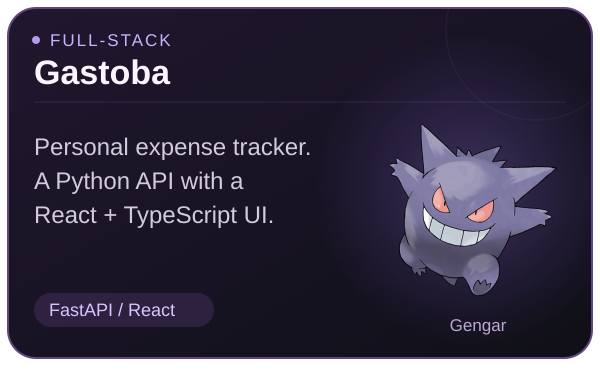
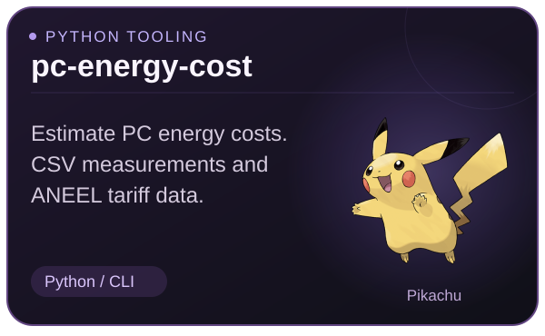
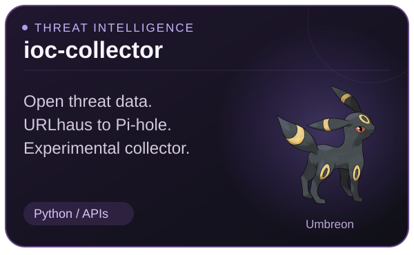
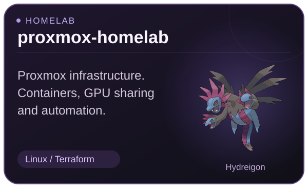
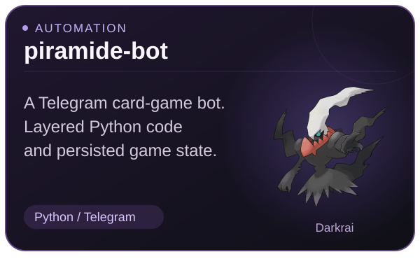

# Fernando Toba Lopez
### Python Backend · Full-stack Development

APIs, automation tools, and React + TypeScript interfaces.  
Security-minded development, backed by hands-on homelab projects.

[LinkedIn](https://www.linkedin.com/in/fernandotobalopez/) · [Email](mailto:fet0b@proton.me) · [Repositories](https://github.com/Fet0b?tab=repositories)

   

I'm an Information Systems student at **Universidade de São Paulo (USP)**. My projects connect software engineering with practical problems in personal finance, data integration, security, and self-hosted infrastructure.

## Featured project · Gastoba

  

**A personal expense tracker with a FastAPI backend and a React + TypeScript interface.** Accounts, budgets, recurring transactions, and charts bring API design, persistence, and user-facing workflows into one project.

[Explore the project](https://github.com/Fet0b/Gastoba) · [Setup and technical details](https://github.com/Fet0b/Gastoba#backend-real)

<strong>View the application · screenshot with fictional data</strong>

The repository includes a local frontend simulation. This screenshot uses fictional accounts and transactions.

## Tools, integrations & infrastructure

  
  
  
  

- **[pc-energy-cost](https://github.com/Fet0b/pc-energy-cost)** — Python CLI for estimating PC energy costs from manual inputs, CSV measurements, and ANEEL tariff data.
- **[ioc-collector](https://github.com/Fet0b/ioc-collector)** — Experimental URLhaus → Pi-hole domain collection and blocklist automation. Additional integrations remain in development.
