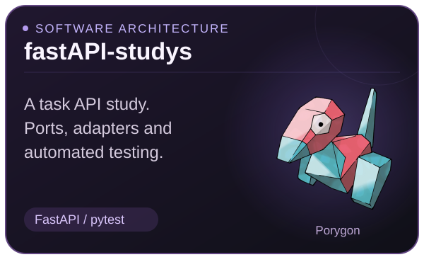

# Fernando Toba Lopez
### Cybersecurity · Threat Intelligence · Software Engineering

Building tools, connecting APIs, and learning through a self-hosted homelab.

[LinkedIn](https://www.linkedin.com/in/fernandotobalopez/) · [Email](mailto:fet0b@proton.me)

   

---

## About me

I'm an Information Systems student at the **Universidade de São Paulo (USP)**, interested in the intersection of security, software design, and infrastructure.

- **Cybersecurity & CTI:** IOC collection, open threat data, and security automation. MISP integrations are an area I want to explore.
- **Software engineering:** Python APIs, separation of concerns, ports and adapters, and automated testing.
- **Homelab:** Linux, Proxmox, containers, and practical infrastructure automation.

## My project team

  
  
  
  
  
  

The collector is experimental; the API repository is a study project. See each repository for setup, scope, and limitations.

## Tools across my projects

**Languages & APIs**  
Python · TypeScript · FastAPI · React

**Infrastructure & workflow**  
Linux · Proxmox · Docker · Terraform · Git · pytest

---

*Build, break, learn, improve.*

Pokémon artwork served by <a href="https://github.com/PokeAPI/sprites">PokéAPI Sprites</a>. Pokémon belongs to its respective rights holders. Personal fan-themed portfolio.

